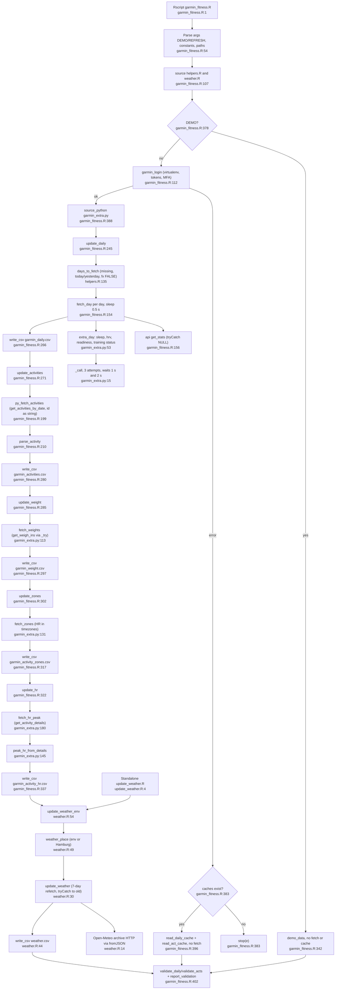

# Feature 1: Abruf & Cache

Quelle: Flowchart-Subagent (nur gelesen, nichts ausgeführt). Nicht gelesen: `garmin_fitness.R` 346–369 und 411–555 (zählen zu Feature 6) sowie die Interna der Bibliothek `garminconnect`.

## Ablauf
- Einstieg `Rscript garmin_fitness.R`, Argumente `--refresh` und `--demo` (`garmin_fitness.R:54-56`). Konstanten `DAYS_BACK = 180`, `PLOT_DAYS = 90`, CSV-Pfade `:71-75`.
- Login `garmin_login()` (`:112-151`): virtualenv `r-garmin`, Tokens in `~/.garminconnect`, MFA per `readline`. Bei Fehler: Abbruch, falls ein Cache fehlt, sonst Warnung und Weiterarbeit ohne Abruf (`:382-396`).
- Ablauf mit gültigem Login (`:388-394`): `source_python("garmin_extra.py")`, dann `update_daily`, `update_activities`, `update_weight`, `update_zones`, `update_hr`, `update_weather_env`.
- `update_daily` (`:245-268`) wählt Tage per `days_to_fetch` (`helpers.R:135-147`): fehlende Tage, heute und gestern, Tage mit `fx_* == FALSE`, Altzeilen ohne `fx_*` und ohne Schlafdaten innerhalb von 14 Tagen. „Keine Daten“-Tage werden nicht erneut geholt. Pro Tag `fetch_day` (`:154-194`) plus `extra_day` (`garmin_extra.py:53`), je 0,5 s Pause.
- `_call` (`garmin_extra.py:15-26`) versucht bis zu dreimal (Wartezeit 1 s, dann 2 s) und liefert `(ok, wert)`. So lässt sich „keine Daten“ von „Fehler“ trennen.
- Aktivitäten (`:271-282`) in einem Aufruf über den ganzen Zeitraum, ohne `tryCatch`. Ein API-Fehler bricht das Skript ab.
- Gewicht (`:285-299`), Zonen (`:302-319`) und Puls-Spitzen (`:322-339`): Zonen und Puls je Aktivität einzeln, nur für noch nicht gecachte IDs.
- Wetter (`weather.R:30-57`): Open-Meteo, die letzten 7 Tage werden neu geholt, Netzfehler führen zu einer Warnung und dem alten Cache. `update_weather.R` ist ein eigenständiger Weg ohne Garmin-Login.

## Flowchart

## Abhängigkeiten zu anderen Features
`days_to_fetch` und `FX_COLS` (`helpers.R:133-147`, Feature 2); `validate_*` (`garmin_fitness.R:402`, Feature 2); `build_dashboard.R` liest alle hier geschriebenen CSVs (Feature 5); `weather_effects` (Feature 4) liest `weather.csv`.

## Schwächen und Auffälligkeiten (nur aus dem Quelltext gelesen)
- Zonen und Puls-Spitzen: Fehlschläge und „keine Daten“ sehen gleich aus (kein Cache-Eintrag). Solche Aktivitäten werden bei jedem Lauf neu abgefragt. Für Tageswerte gibt es dafür `fx_*`-Flags.
- `update_activities` hat kein `tryCatch`. Ein Fehler dort verhindert Gewicht, Zonen und Puls.
- `--refresh` setzt `old` überall auf `NULL` außer beim Wetter. Für Zonen und Puls bedeutet das einen API-Aufruf je Aktivität mit `avg_hr`.
- Randfall ungeprüft: Ohne Cache und ohne neue Aktivitäten könnte `arrange(start)` an einer fehlenden Spalte scheitern.

## Duplikate (Belege)
- 180-Tage-Fenster: `garmin_fitness.R:58` und Standardwert `helpers.R:135`.
- `RIDE_GAP_MIN` und `RIDE_MIN_MIN`: `garmin_fitness.R:61-62`, `build_dashboard.R:25-26`.
- `fx_*`-Namen in drei Stellen, die synchron bleiben müssen: `garmin_extra.py:73`, `garmin_fitness.R:191-192`, `helpers.R:133`.
- `col_types` der Aktivitäten: `garmin_fitness.R:238-241`, `build_dashboard.R:36-38` und `:53-55`. Zonen und Puls: `garmin_fitness.R:304` und `:324`, `build_dashboard.R:46` und `:49`.
- Wetter-CSV-Schema: `weather.R:37` und `build_dashboard.R:32`.
- Tages-CSV mit uneinheitlichen Spaltentypen: `garmin_fitness.R:230-234`, `build_dashboard.R:29`, `update_weather.R:6`.
- `num()`-Hilfsfunktionen: `garmin_fitness.R:97`, `weather.R:23`, `weather.R:50`, `load_recovery.R:122`.

## Konfidenz
Hoch für Kontrollfluss und Zuordnung Funktion → CSV. Die Stichprobe der Zeilenangaben (RIDE_*) stimmt mit dem Quelltext überein.
