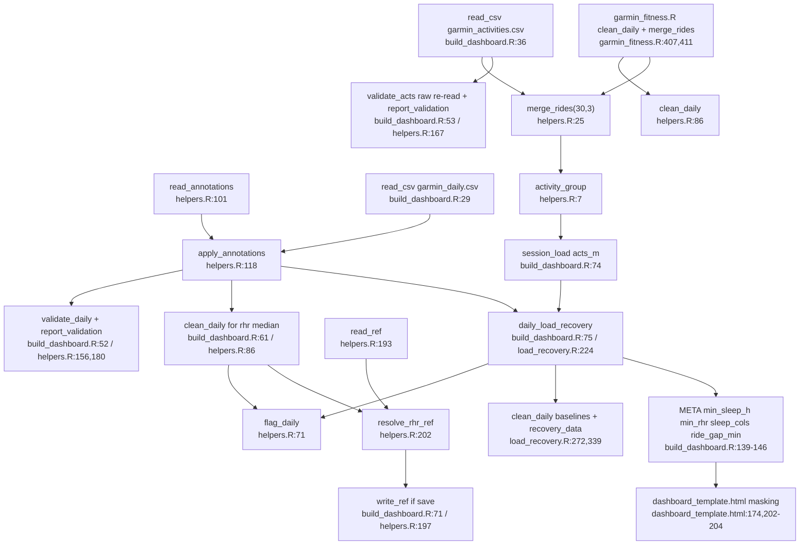

# Feature 2: Bereinigung, Annotationen & Validierung

Quelle: Flowchart-Subagent (nur gelesen). Nicht geprüft: Inhalt der (git-ignorierten) `annotations.csv`, Interna von `update_daily`.

## Funktionen in `scripts/helpers.R`
- `activity_group` (`:7-17`): Regex-Reihenfolge Rad, Laufen, Gym/HIIT, Gehen/Wandern, Segeln/Wasser, sonst „Sonstiges“.
- `merge_rides` (`:25-51`): führt nur `type_key == "cycling"` zusammen (Lücke über 30 min oder anderer Kalendertag = neue Fahrt). Fahrten unter 3 min fallen weg. `e_bike` und `indoor_cycling` werden nicht zusammengeführt, `activity_group` ordnet sie aber „Rad“ zu.
- Schwellen `MIN_SLEEP_H = 5`, `MIN_RHR = 45`, `MIN_STEPS = 500` (`:56-58`), `SLEEP_COLS` (`:61-63`).
- `flag_daily` (`:71-81`) setzt `sleep_bad`, `rhr_bad`, `partial`, ändert aber keine Werte. `clean_daily` (`:86-92`) setzt Schlafspalten bei `sleep_bad` und Ruhepuls bei `rhr_bad` auf `NA`. `clean_daily` reicht `min_steps` nicht an `flag_daily` durch (immer Standardwert).
- Annotationen: `read_annotations` (`:101-115`, bricht bei fehlerhaftem Schema oder Datum mit `stop()` ab), `apply_annotations` (`:118-127`).
- `days_to_fetch` (`:135-147`), `validate_daily` (`:156-165`), `validate_acts` (`:167-178`), `report_validation` (`:180-187`, nur Meldungen, kein Abbruch).
- `read_ref`, `write_ref`, `resolve_rhr_ref` (`:193-207`): Priorität Umgebungsvariable `RHR_REF`, dann gespeicherter Wert, sonst neu berechnet. Ein defektes `profile.json` führt zu `list()` und Neuberechnung.

## Aufrufstellen
`build_dashboard.R:29-30` (Tageswerte + Annotationen), `:36-41` (Aktivitäten + `merge_rides` + `activity_group`), `:52-56` (Validierung), `:60-71` (Referenzwerte), `:75` (`daily_load_recovery` ruft `flag_daily`, `load_recovery.R:225`). `garmin_fitness.R:402-413` (Plot-Pfad).

## Flowchart

## Auffälligkeiten (nur gelesen, nicht ausgeführt)
- `garmin_fitness.R` wendet keine Annotationen an (`:407`). Die PNG-Plots behandeln annotierte kurze Nächte deshalb als schlecht, das Dashboard nicht.
- `validate_acts` läuft in `build_dashboard.R:53-56` auf der zweimal eingelesenen, nicht zusammengeführten CSV.
- `clean_daily` reicht `min_steps` nicht durch.
- Ein fehlerhaftes `annotations.csv` bricht den ganzen Dashboard-Build ab.
- Ungleichheit bei der Erkennung von Rädern: `merge_rides` nutzt exakt `"cycling"`, `activity_group` die Regex `cycling|biking|ride`.

## Duplikate (Belege)
- `RIDE_GAP_MIN` und `RIDE_MIN_MIN`: `garmin_fitness.R:61-62`, `build_dashboard.R:25-26`, Standardwerte `helpers.R:25`, außerdem als Literale `merge_rides(…, 30, 3)` in `tests/testthat/test-helpers.R:13,24,31,38,43,50` und in sechs `tests/audit/*.R`.
- `MIN_SLEEP_H` und `MIN_RHR` haben eine Definition (`helpers.R:56-57`) und kommen über `META` (`build_dashboard.R:145`) ins JS. Das JS bildet `clean_daily` clientseitig nach (`dashboard_template.html:202-203`). `META.min_rhr` wird nicht gelesen.
- `MIN_STEPS = 500`: `helpers.R:58` und `load_recovery.R:239`.
- Literal `"cycling"`: `helpers.R:27`, `load_recovery.R:105` und `:137`, `garmin_fitness.R:362`.
- Plausibilitätsgrenzen `check_row` (`helpers.R:163-164`, 30–100 bpm, 0–16 h) sind separate Festwerte.

## Konfidenz
Hoch für `helpers.R` und die Aufrufstellen.
