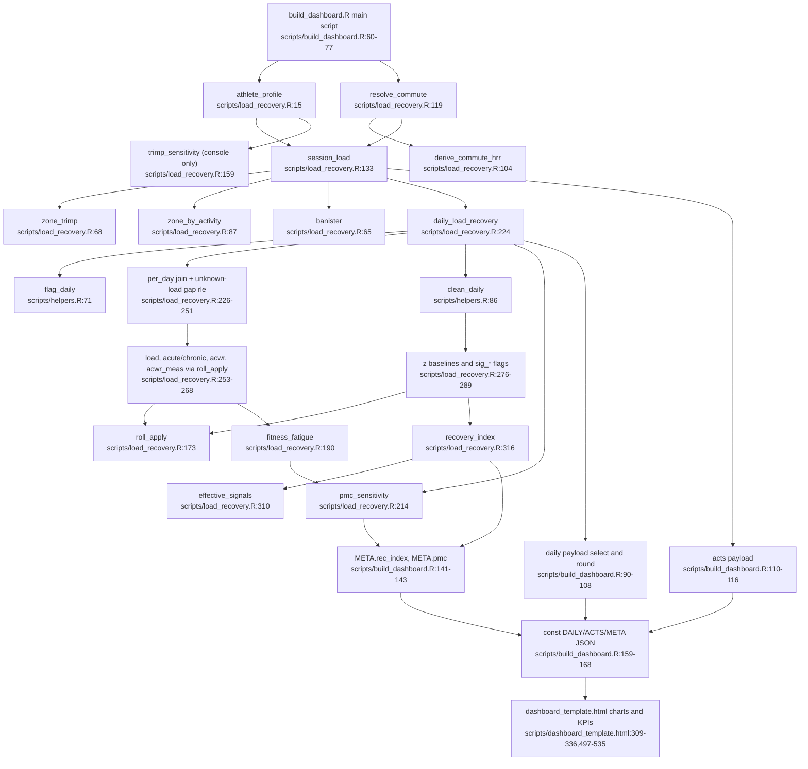

# Feature 3: Belastung & Erholung

Quelle: Flowchart-Subagent (nur gelesen). `scripts/load_recovery.R:1-336` wurde vollständig gelesen. Nicht gelesen: Testkörper, `helpers.R:110-215`. Die Spaltenexistenz in den echten CSVs (`hrv_night`, `bb_high`, `te_aerobic`) ist nur aus dem Code abgeleitet.

## Ablauf (einzige Aufrufkette in `build_dashboard.R`)
- `athlete_profile` (`load_recovery.R:15`): HFmax aus `HRMAX` oder Tanaka (`208 - 0.7·Alter`, `:23`), Obergrenze Tanaka + 30 (`:29`), Banister-Faktor 1,92/1,67, Karvonen-Zonen (`:32-34`).
- `resolve_commute` (`:119`) mit `derive_commute_hrr` (`:104`): Median der Herzfrequenzreserve gemessener Fahrten, ab 5 Fahrten, sonst 0,40.
- `session_load` (`:133`): TRIMP je Einheit, bei vorhandenen Zonen je Zone (`zone_trimp` `:68`, `zone_by_activity` `:87`), `trimp_src` = „zonen“, „geschätzt“ oder „durchschnitt“.
- `daily_load_recovery` (`:224`):
  1. `flag_daily` (`:225`), Last je Tag (`:226-233`).
  2. Unbekannte Last (`:238-251`): Läufe von 10 Tagen oder mehr ohne Aktivität werden `load_unknown` (Uhr getragen, ab 50 % Tage mit mindestens 500 Schritten) oder `no_wear`. Annotationen überschreiben das.
  3. ACWR (`:253-268`): 7-Tage-Mittel gegen 28-Tage-Mittel mit `roll_apply` (`:173`), Mindestwerte 5 und 14, `chronic ≥ 1`. Dazu eine Variante nur mit gemessener Last.
  4. PMC (`:269`) über `fitness_fatigue` (`:190`), τ = 42 und 7, Start Mittel der ersten 14 nutzbaren Tage, unbekannte Tage frieren den Zustand ein.
  5. Baselines (`:272-283`): 28 Tage, um einen Tag verzögert, mindestens 14 Werte, z-Werte für Ruhepuls, Schlaf-Score, Body Battery und ln-HRV.
  6. `recovery_index` (`:316`): Mittel der vier z-Werte durch die eigene SD über alle Tage, mindestens 3 von 4 Signalen, Schwelle −1,5 (`REC_INDEX_THRESHOLD` `:308`).
- `pmc_sensitivity` (`:214`) liefert den Endstand bei „einfrieren“, „Median auffüllen“ und „0 setzen“.

Im JSON-Payload fehlen `load` (Summe), die z-Spalten und `load_acwr`. Das Template bekommt nur `load_meas` und `load_est` (`build_dashboard.R:98-108`).

## Flowchart

## Abhängigkeiten
`flag_daily`, `clean_daily`, `MIN_STEPS`, `sum_na`, `max_na`, `apply_annotations`, `merge_rides`, `read_ref`, `resolve_rhr_ref` aus `helpers.R` (Feature 2). `recovery_data` und `recovery_model` (Feature 4) verbrauchen `dl` einschließlich `hiit` und der Flags.

## Randfälle (nur gelesen)
- Kürzere inaktive Phasen als 10 Tage zählen als Last 0. Eine 9-tägige Lücke geht also als echte Nulllast in ACWR und CTL ein.
- Partielle und unbekannte Tage frieren den PMC-Zustand ein, `ctl` und `atl` sind trotzdem gefüllt (nachgezogen) und über `pmc_gap` markiert.
- Die SD des Erholungs-Index kommt aus dem Gesamtzeitraum (nicht kausal, im Code als beschreibend dokumentiert, Schwelle nicht validiert, `:306`).
- `pmc_warmup = seq_len(n) <= tau_fit` (`:199`) zählt Kalendertage. Das entspricht Kommentar und Notion.

## Duplikate (Belege)
- Rollierendes Mittel: `load_recovery.R:173-180` `roll_apply`, `garmin_fitness.R:100-106` `roll_mean`, `dashboard_template.html:207-210` `roll`.
- ACWR-Band 0,8/1,3 nur im Template: `:134`, `:311-312`, `:392-394`, `:510`. In R keine Konstante.
- Weitere Schwellen nur im Template: Training-Readiness-Bänder 25/50/75 (`:152`, `:523`), Index-Farbstufe −1 (`:482`), Warnschwelle „3 in 14 Tage“ (`:314`, `:336`), `HEAT_C = 30` (`:537`).
- Herzfrequenzreserve-Formel `pmin(pmax((x - rhr_ref)/(hrmax - rhr_ref),0),1)` mehrfach: `load_recovery.R:74`, `:106`, `:120`, `:136-138`. Zonengrenzen `c(.5,.6,.7,.8,.9)`: `:33-34`, `:140`, `:70-73`.
- Tanaka-Formel `208 - 0.7 * age`: `load_recovery.R:23` und `:29`.
- Ausschluss partieller Tage: `helpers.R:79`, Template `:206`. `tests/audit/audit2.R:43-44` rechnet den ACWR noch einmal nach.
- `tau_fit` und `tau_fat` haben eine einzige Quelle (`formals(fitness_fatigue)`) und gehen über `META.pmc` an das JS. Das ist die Vorlage für die übrigen Schwellen.

## Konfidenz
Hoch für den Ablauf in `load_recovery.R:1-336` und die Aufrufstellen. Mittel für die Zeilen der Last-Diagramme im Template.
