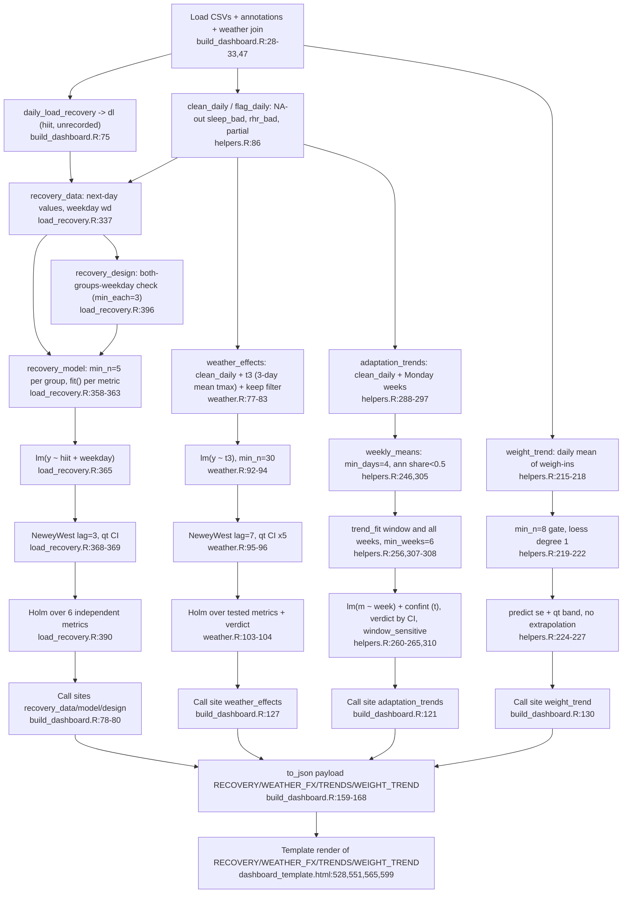

# Feature 4: Inferenz-Module

Quelle: Flowchart-Subagent (nur gelesen). Nicht gelesen: das Template im Ganzen (nur Fundstellen), `daily_load_recovery`-Interna, Testkörper. Ob `sandwich` als Abhängigkeit deklariert ist, ist offen (es gibt weder `DESCRIPTION` noch `renv.lock`).

## Module
- **`recovery_data`/`recovery_model`/`recovery_design`** (`load_recovery.R:337-401`): `lm(y ~ hiit + droplevels(wd))` je Kennwert, Newey-West (Lag 3, `:368`), Intervall mit `qt(.975, df.residual)`, p manuell berechnet (`:372`), Cohen-d aus der gepoolten Gruppen-SD (`:370`), Sensitivität nur für Wochentage mit beiden Gruppen (`:359`, `:378`). Holm über die Kennwerte mit `independent == TRUE`, 6 von 7 (`:390`). Mindestanzahl 5 je Gruppe (`:363`). Aufruf `build_dashboard.R:78-80`.
- **`weather_effects`** (`weather.R:74-106`): Mittel der Höchsttemperatur von Tag und zwei Vortagen (`t3`, `:79-82`), `lm(y ~ t3)`, Newey-West Lag 7 (`:95`), Effekt je +5 °C (`:96`), HRV zurückgerechnet (`:97`), Holm über alle getesteten Kennwerte (`:103`), Mindestanzahl 30 (`:92`). Aufruf `build_dashboard.R:127`.
- **`adaptation_trends`** (`helpers.R:273-319`): Wochenmittel (mindestens 4 Tage, Anteil annotierter Tage unter 0,5), `trend_fit` zweimal (12-Wochen-Fenster und alle Wochen, jeweils mindestens 6 Wochen), `lm` + `confint` (`:260-261`), `window_sensitive` (`:310`). Aufruf `build_dashboard.R:121`.
- **`weight_trend`** (`helpers.R:215-228`): ab 8 Tagen, `loess` Grad 1, Band aus `qt(.975, df)·se.fit`. Aufruf `build_dashboard.R:130`.

Kleinigkeit: `recovery_design(x)` wird in `load_recovery.R:359` doppelt berechnet.

## Flowchart

## Gemeinsames Muster und Abweichungen
Muster: `clean_daily`, dann Mindest-n, dann Regression oder Glätter mit Intervall aus `qt` auf den Residualfreiheitsgraden, dann Urteil. Unterschiede liegen nur im Standardfehler und in der p-Wert-Behandlung.

| Aspekt | Erholung | Wetter | Wochentrends | Gewicht | Einordnung |
|---|---|---|---|---|---|
| Autokorrelation | Newey-West Lag 3 (`load_recovery.R:368`), Lückenannäherung dokumentiert (`:356-357`) | Newey-West Lag 7 (`weather.R:95`), gefilterte Zeilen gelten als aufeinanderfolgend, nicht dokumentiert | keine, Wochenmittel mit einfachem `confint` (`helpers.R:261`), Einschränkung dokumentiert (`:237-239`) | keine, `loess` `se.fit` (`:224-225`) | Lag 3 gegen 7 ist teils begründbar (Folgetag-Kontrast gegen 3-Tage-Prädiktor), im Code aber nicht begründet. Wochentrends ohne NW sind vertretbare Spezialisierung. |
| Mehrfachtest | Holm über 6 unabhängige Kennwerte, Bereitschaft ausgenommen (`:390`) | Holm über alle getesteten Kennwerte (`:103`), Familiengröße schwankt mit der Regel n ≥ 30 | keine über 3 Kennwerte und 2 Fenster | entfällt | **Zufällige Lücke** bei den Wochentrends. Das Urteil „hängt vom Fenster ab“ (`:310`) fängt einen Teil ab. |
| Mindest-n | 5 je Gruppe (`:358`, `:363`), `min_each = 3` je Wochentag (`:396`) | 30 Zeilen (`:74`, `:92`) | 4 Tage je Woche, 6 Wochen (`:273`, `:259`) | 8 Wiegungen (`:215`, `:219`) | Je Einheit begründbar. 5 je Gruppe ist dünn für bis zu 7 Wochentag-Dummys plus Newey-West. |
| Intervall | `est ± qt·se_NW` (`:369-371`) | `5·b ± qt·5·se` (`weather.R:96`) | `confint(lm)` (`helpers.R:261`) | `qt·se.fit` (`:225-227`) | Alle nutzen `qt` mit Residual-df. Nur die Quelle des SE unterscheidet sich. p wird nur bei Erholung und Wetter manuell berechnet. |
| Log-Behandlung | keine | HRV log, Effekt in % (`weather.R:90`, `:97`) | HRV log, % je Woche (`helpers.R:304`, `:262`) | keine | Der Faktor `100·(exp(z)−1)` steht doppelt, Kandidat zum Teilen. |
| Ausschluss | `unrecorded` und `sleep_bad` (`load_recovery.R:340`, `:347`) | `!partial` und keine Annotation (`weather.R:83`) | `partial` auf `NA`, Anteil annotierter Wochen (`helpers.R:302`, `:250`) | keiner | Der Umgang mit Annotationen weicht ab: `recovery_data` ignoriert `ann_note`. Wirkt zufällig. |

Der `NeweyWest`/`qt`/p-Wert-Block steht an zwei Stellen (`load_recovery.R:368-372`, `weather.R:95-99`), mit dem Lag als einzigem Unterschied. Das ist ein Kandidat für eine gemeinsame Hilfsfunktion.

## Konfidenz
Hoch für Modellcode und Aufrufstellen. Die Abweichungsaussagen zu Newey-West und Holm habe ich mit `grep` gegen `NeweyWest` in `load_recovery.R:368` und `weather.R:95` bestätigt.
