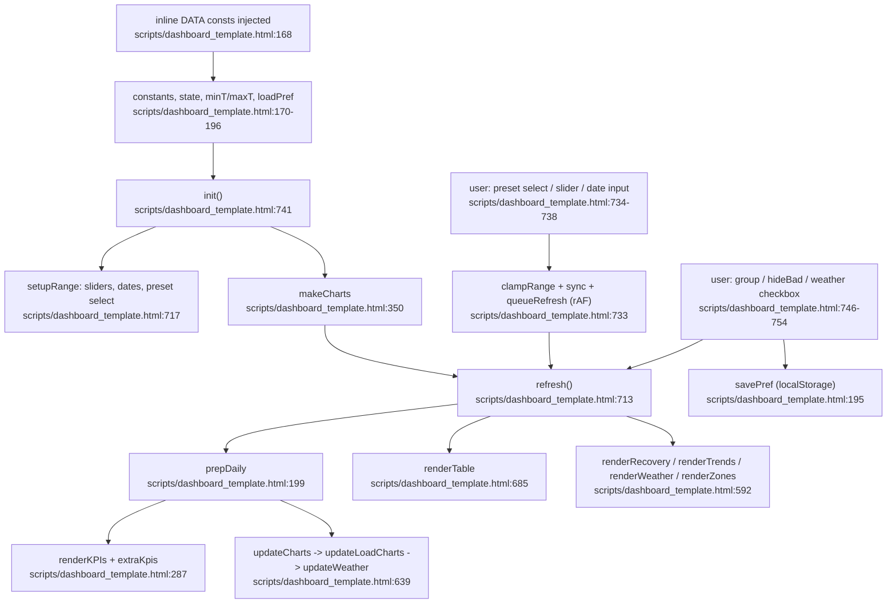

# Feature 5: Dashboard-Build & Frontend

Quelle: Flowchart-Subagent (nur gelesen; beide Dateien vollständig). Nicht ausgeführt, Seite nicht geöffnet. Nicht geprüft: ob alle Spalten, die `select()` in `build_dashboard.R:98-108` erwartet, wirklich entstehen.

## Build-Seite (`Rscript scripts/build_dashboard.R`)
- Locale und Pakete `:14-19`, `source()` von `helpers.R`, `load_recovery.R`, `weather.R` `:20-22`.
- Tageswerte + Annotationen + Wetter (`:28-34`), Aktivitäten (`:36-41`), optionale CSVs `read_opt` (`:44-49`), Validierung (`:52-56`).
- Referenzwerte (`:60-71`), Last und Erholung (`:74-80`), `daily` (`:90-108`), `acts` (`:110-116`), Trends, Wetter, Gewicht (`:118-132`), `meta` (`:136-157`).
- `to_json` (`:159`), acht `const X = …;`-Zeilen (`:160-168`), Template an `/*__DATA__*/` geteilt (`:170-174`), Ausgabe `_outputs/fitness_dashboard.html` (`:176-178`). `:179-212` ist reine Konsolendiagnose.

## Datenvertrag R → JS
| JS-Konstante | Erzeuger | Verbraucher |
|---|---|---|
| `DAILY` | `build_dashboard.R:90-108` | `prepDaily :199`, `kpiValues :267`, `renderKPIs :291`, `updateCharts :639` |
| `ACTS` | `:110-116` | `kpiValues :269`, `estShare :485`, `renderZones :615`, `renderTable :687` |
| `WEIGHT` / `WEIGHT_TREND` | `:118-119` / `:130-132` | `extraKpis :321`, `updateLoadCharts :527-528` |
| `TRENDS` | `:121-125` | `renderTrends :565` |
| `WEATHER_FX` | `:127` | `renderWeather :551` |
| `RECOVERY` | `:78-79` | `renderRecovery :599` |
| `META` | `:136-157` | Schlüssel siehe unten |

`META` liefert `min_sleep_h`, `sleep_cols` (`:174`), `rec_index.threshold` (`:336`, `:482`, `:535`), `pmc.tau_fit/tau_fat/sens` (`:498-504`), `ride_gap_min` (`:695`), `profile`, `weather`, `recovery_design`. **Nicht gelesen** werden `META.min_rhr` und `META.ride_min_min`.

## Browser-Seite
Seitenstart `init()` (`:741`) füllt Gruppenfilter, `setupRange` (`:717`), `makeCharts` (`:350`), `refresh()` (`:713`). `refresh()` ruft `prepDaily`, `renderKPIs`, `updateCharts`, `renderTable`, `renderRecovery`, `renderTrends`, `renderWeather`, `renderZones`. Zeitraumwechsel läuft über `clampRange`, `sync`, `queueRefresh` (`:724-738`). Anpassungs-Trends, HIIT-Erholung und die Wetter-Tabelle ignorieren den Zeitraum. Die Gruppenauswahl wirkt nur auf Wochendiagramm und Tabelle.

## Flowcharts
Build-Seite:

```mermaid
flowchart TD
  A["Rscript entry + source helpers/load_recovery/weather<br/>scripts/build_dashboard.R:14-22"]
  B["read garmin_daily.csv + apply_annotations + weather join<br/>scripts/build_dashboard.R:28-34"]
  C["read garmin_activities.csv, merge_rides, activity_group<br/>scripts/build_dashboard.R:36-41"]
  D["read_opt zones/weight/hr CSVs<br/>scripts/build_dashboard.R:44-49"]
  E["validate_daily/validate_acts<br/>scripts/build_dashboard.R:52-56"]
  F["read_ref, resolve_rhr_ref, athlete_profile, resolve_commute, write_ref<br/>scripts/build_dashboard.R:60-71"]
  G["session_load, daily_load_recovery, pmc_sensitivity<br/>scripts/build_dashboard.R:74-77"]
  H["recovery_data, recovery_model, recovery_design<br/>scripts/build_dashboard.R:78-80"]
  I["daily tibble (to_clock_h, select)<br/>scripts/build_dashboard.R:82-108"]
  J["acts tibble<br/>scripts/build_dashboard.R:110-116"]
  K["weights, adaptation_trends, weather_effects, weight_trend<br/>scripts/build_dashboard.R:118-132"]
  L["hr_peak_stats + meta list<br/>scripts/build_dashboard.R:134-157"]
  M["to_json + payload (8 const lines)<br/>scripts/build_dashboard.R:159-168"]
  N["read template, split on /*__DATA__*/<br/>scripts/build_dashboard.R:170-174"]
  O["writeLines to _outputs/fitness_dashboard.html<br/>scripts/build_dashboard.R:176-178"]
  P["console diagnostics (trimp_sensitivity etc.)<br/>scripts/build_dashboard.R:179-212"]
  A --> B --> C --> D --> E --> F --> G --> H --> I --> J --> K --> L --> M --> N --> O --> P
```

Browser-Seite:

## Abhängigkeiten
`helpers.R`, `load_recovery.R`, `weather.R` und alle `data/*.csv` aus Feature 1. Chart.js 4.5.1 kommt von jsdelivr (`dashboard_template.html:7`), die Ansicht braucht also Netz. Umgebungsvariablen `HRMAX`, `BIRTHDAY`, `GENDER`, `RHR_REF`. Die Tests `tests/js/test_date_range.mjs` und `test_weight_change.mjs` lesen die Blöcke `<dateRange>` und `<weightChange>` per Regex aus dem Template. Die Marker dürfen nicht verschoben werden.

## Auffälligkeiten (nur gelesen)
- `Math.max(...DAILY.map(...))` (`:189-190`) liefert bei leerem `DAILY` `-Infinity`.
- `hrvCls` (`:319`): der dritte Zweig ist redundant.
- `dec()` in `renderRecovery` (`:594`) wählt Dezimalstellen anhand deutscher Namensbestandteile („Tiefschlaf“, „puls“). Eine Umbenennung in R ändert die Formatierung stillschweigend.
- Die Mindestzahl für den Gewichtstrend steht im Text als „8 Wiegungen“ (`:155`), `weightChange` nutzt `minN = 6` (`:248`). Das ist laut Notion beabsichtigt (Trend ab 8, Änderung ab 6), aber an zwei Stellen von Hand gepflegt.

## Duplikate (Belege)
**R gegen JS**
| Eintrag | R | JS |
|---|---|---|
| `STEP_GOAL` 10000 | `garmin_fitness.R:60` | `:173` |
| `GROUP_COLORS` (6 Gruppen) | `garmin_fitness.R:78-85` | `:170` |
| Gruppennamen „Rad“, „Gym / HIIT“ | `helpers.R:7-17` | `:170`, `:274`, `:275`, `:663`, `:664` |
| 7-Tage-Mittel (mindestens 3) | `garmin_fitness.R:100-105` | `:207-210` |
| Teilwoche | `garmin_fitness.R:472` | `:657` |
| ACWR-Band 0,8/1,3 | keine R-Konstante | `:134`, `:311-312`, `:393-394`, `:510` |
| Hitzetag 30 °C | keine R-Konstante | `HEAT_C :537` |
| `MIN_RHR` | `helpers.R:57` | über `META.min_rhr` exportiert, aber ungenutzt (JS nutzt `rhr_bad`, `:202`) |
| `MIN_STEPS` | `helpers.R:58` | nicht in `META` |
| „ab 4 gültigen Tagen“ | `helpers.R:273` | Text `:589` |

**Innerhalb des JS**
- Legenden-Optionen, `ticks`-Optionen und Farben (`#0072B2`, `#E69F00`, `#D55E00`, `#CC79A7`, `#B3261E`, `#56B4E9`, `#1a7f4b`, `#A6C8E0`) an vielen Stellen wiederholt (`:345`, `:358`, `:370`, `:382`, … und `:170`, `:356`, `:395`, `:421`, …).
- `fmtP` zweimal definiert (`:554`, `:593`). Vorzeichen-Hilfen `sg`/`sgn` an vier Stellen (`:324`, `:555`, `:573`, `:595`).
- `DAY = 86400000` (`:173`) und `MS_DAY` in `weightChange` (`:249`, mit Absicht, weil der Block getrennt getestet wird).

## Konfidenz
Hoch für Build-Ablauf und Schlüsselzuordnung. Die Stichprobe zu `fmtP` (`:554`, `:593`), `HEAT_C` (`:537`), ACWR-Band (`:311`, `:312`, `:510`) und `STEP_GOAL`/`GROUP_COLORS` (`:170`, `:173`) stimmt mit dem Quelltext überein.
