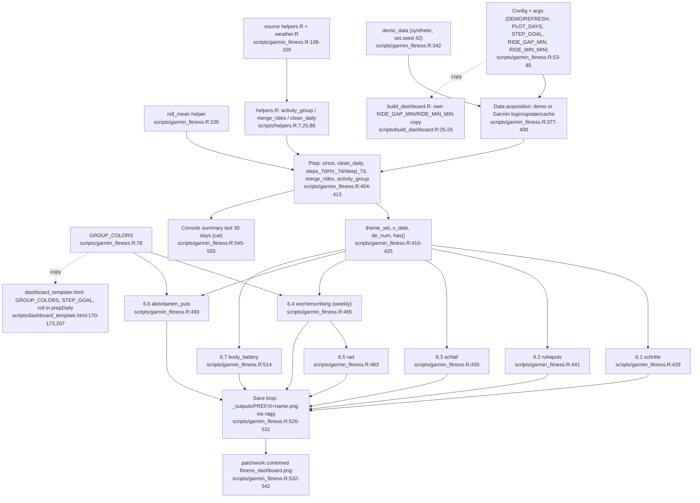

# Feature 6: Legacy-PNG-Plots & Konsolenbericht

Quelle: Flowchart-Subagent, Stand `main` @ `747898f`. Der Subagent hat nur gelesen und nichts ausgeführt. Die Stichprobe der `file:line`-Labels gegen den Quelltext steht noch aus (siehe Verifikation im Plan).

## Ablauf (Normallauf, nicht `--demo`)
- Daten laden (`scripts/garmin_fitness.R:377-402`). Die CSVs schreiben andere Features.
- Auf die letzten `PLOT_DAYS = 90` Tage begrenzen und `clean_daily()` anwenden (`:404-413`).
- Sieben ggplots bauen (`:429-522`), je Plot ein PNG nach `_outputs/<PREFIX><name>.png` (`:528-531`, 9 × 4,5 in, 150 dpi, `ragg` falls vorhanden).
- Kombiniertes Patchwork-PNG `_outputs/<PREFIX>fitness_dashboard.png` (`:532-542`), nur bei mindestens 2 Plots und installiertem `patchwork`.
- Konsolenblock „Letzte 30 Tage“ per `cat()` (`:546-555`).
- `PREFIX` ist `"demo_"` bei `--demo`, sonst leer (`:76`). `_outputs/*` ist git-ignoriert.

## Plot gegen Dashboard
| Plot | Datei | Entsprechung im Dashboard |
|---|---|---|
| 6.1 `schritte` (`:429-439`) | schritte.png | `c-steps` (`dashboard_template.html:123`, `:353-360`, Daten `:645`) |
| 6.2 `ruhepuls` (`:441-448`) | ruhepuls.png | `c-rhr` (`:124`, `:361-364`, `:646`) |
| 6.3 `schlaf` (`:450-463`) | schlaf.png | `c-sleep` (`:125`, `:365-370`, `:647`), Farben gleich (`PHASE_COLORS :172`) |
| 6.4 `wochenumfang` (`:465-481`) | wochenumfang.png | `c-week` (`:127`, `:377`, `:656-663`), Dashboard mit Gruppenfilter |
| 6.5 `rad` (`:483-491`) | rad.png | `c-ride` (`:128`, `:468`, `:664-666`) |
| 6.6 `aktivitaeten_puls` (`:493-512`) | aktivitaeten_puls.png | **keine** (nur Tabellenspalte „Ø Puls“ `:676`) |
| 6.7 `body_battery` (`:514-522`) | body_battery.png | `c-bb` (`:126`, `:371-375`, `:648`) |

6 von 7 Plots haben eine Entsprechung. Plot 6.6 (Puls je Aktivität mit loess-Trend je Gruppe ab n ≥ 8) hat keine.

## Flowchart

## Abhängigkeiten zu anderen Features
- Liest die CSVs aus Feature 1 (`update_daily`, `update_activities`, `read_*_cache`, `garmin_login`). Im Normallauf ist das Feature nicht eigenständig.
- Nutzt `activity_group`, `merge_rides`, `clean_daily` (Feature 2). `validate_daily`, `validate_acts` und `report_validation` laufen nur im Normallauf.
- `weather.R` wird eingebunden (`:109`), die Plots nutzen es nicht.
- `build_dashboard.R` bindet `garmin_fitness.R` nicht ein (`build_dashboard.R:20-22` lädt nur `helpers.R`, `load_recovery.R`, `weather.R`). Die Kopplung ist rein textlich: Kommentare „wie in garmin_fitness.R“ (`build_dashboard.R:25`) und „wie roll_mean() in R“ (Template `:207`). Das Dashboard braucht die CSVs, die dieses Skript schreibt.
- Der Demo-Modus kann das Dashboard nicht speisen, weil `build_dashboard.R` nur die `data/`-CSVs liest.

## Duplikate gegenüber dem Dashboard
- `RIDE_GAP_MIN = 30`, `RIDE_MIN_MIN = 3`: `garmin_fitness.R:61-62`, `build_dashboard.R:25-26`, Standardwerte in `helpers.R:25` (dritte Kopie).
- `GROUP_COLORS` (6 Gruppen, gleiche Hex-Werte): `garmin_fitness.R:78-85`, `dashboard_template.html:170-171`. Die Gruppennamen stehen außerdem in `helpers.R:7-19`.
- `STEP_GOAL = 10000`: `garmin_fitness.R:59`, `dashboard_template.html:173`.
- 7-Tage-Mittel mit mindestens 3 Werten: `garmin_fitness.R:100-105`, Template `roll` `:207-211`.
- Ausschluss unvollständiger Tage (`steps_c` / `steps_ok`): `garmin_fitness.R:408`, Template `:205`.
- Schlafphasen-Farben: `garmin_fitness.R:455-456`, Template `:172`.
- Diagrammfarben (Schritte, Ruhepuls, Body Battery): `garmin_fitness.R:431-437`, `:443-446`, `:516-519`, Template `:354-375`.
- Wochenbildung und Teilwoche: `garmin_fitness.R:465-473`, Template `:654-663`.
- Plotfenster `PLOT_DAYS = 90`: `garmin_fitness.R:58`, Dashboard-Voreinstellung `presetRange(90, …)` Template `:196`.

## Konfidenz und Lücken
Hoch bei den geschriebenen Dateien, der Plot-Zuordnung und der Unabhängigkeit vom Dashboard-Build. Nicht geprüft: Ausführung des Skripts, Abgleich der Dashboard-KPIs mit dem Konsolenblock, Bezüge in `tests/` (die Grep-Abfrage lief zusammen mit einem Fehler). Die README sagt nicht, dass das Dashboard die PNGs ersetzt, und nicht, dass Plot 6.6 keine Entsprechung hat.
