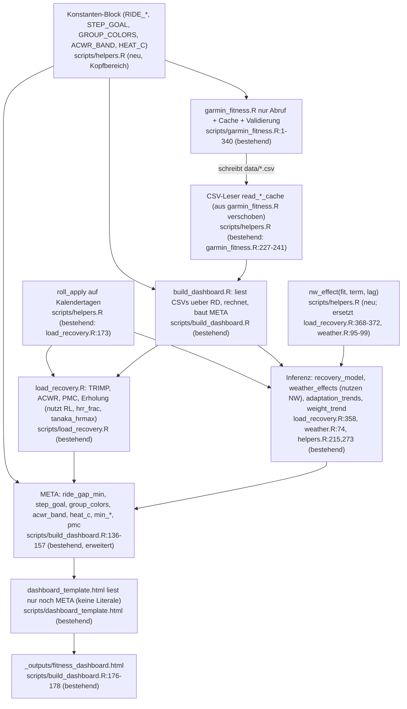

# Vereinfachungsvorschlag (Pathfinder Phase 3)

Grundlage: `02-duplication-report.md`. Leitlinie: löschen vor abstrahieren, ein Weg statt zwei, keine Feature-Flags, keine neue Ebene „für Flexibilität“. Wo eine Hilfsfunktion nötig ist, gibt es sie schon im Repo (Beleg jeweils dabei).

Das Projekt ist klein (rund 2.000 Zeilen R/Python, 764 Zeilen Template). Der Vorschlag umfasst deshalb sechs kleine Systeme (S1–S6) statt eines Umbaus. Jedes lässt sich einzeln umsetzen und einzeln zurücknehmen.

## S1 – Eine Quelle für Konstanten, das JS liest `META`

- **Problem:** A1–A5, A8 im Duplikat-Bericht. `RIDE_*` steht an drei Stellen, `STEP_GOAL`, `GROUP_COLORS`, ACWR-Band und `HEAT_C` stehen nur im Frontend.
- **Zielkomponente:** ein Block „Konstanten“ am Anfang von `scripts/helpers.R`. Die Datei wird schon von allen drei Skripten eingebunden (`garmin_fitness.R:107`, `build_dashboard.R:20`, `update_weather.R`), eine neue Datei ist nicht nötig.
- **Einziger Einstiegspunkt:** `build_dashboard.R:136-157` (`meta`). Das Muster gibt es bereits für `min_sleep_h`, `sleep_cols` und `tau_fit`/`tau_fat` (`formals(fitness_fatigue)`).
- **Aus jeder alten Stelle wird:**
  - `garmin_fitness.R:61-62` und `build_dashboard.R:25-26` fallen weg, beide lesen die Konstanten aus `helpers.R`. Standardwerte `helpers.R:25` verweisen auf dieselben Variablen. `META.min_rhr` und `META.ride_min_min` werden entweder vom JS gelesen oder aus `meta` entfernt.
  - `dashboard_template.html:173`, `:170`, `:311-312`, `:393-394`, `:510`, `:537` lesen `META.step_goal`, `META.group_colors`, `META.acwr_band`, `META.heat_c`.
- **Gegentest:** ein JS- oder R-Test, der prüft, dass die Schwellen im Template nicht mehr als Literale auftauchen. Ein Muster dafür sind `tests/js/test_date_range.mjs` und `test_weight_change.mjs`.
- **Capability-Verlust:** keiner. Die Kommentare „wie in garmin_fitness.R“ entfallen.

## S2 – Ein Rollmittel auf Kalendertagen

- **Problem:** B1, B2. `roll_mean` und `roll_apply` sind dasselbe, und beide zählen Zeilen statt Tage.
- **Zielkomponente:** `roll_apply` (`load_recovery.R:173`) zieht nach `helpers.R` und arbeitet über die Datumsspalte (fehlende Tage zählen als `NA`). `roll_mean` (`garmin_fitness.R:100`) fällt weg, wenn S3 es nicht ohnehin löscht.
- **JS bleibt:** `prepDaily` (`dashboard_template.html:207-210`) rollt nach dem clientseitigen Maskieren und ist deshalb legitim. Ein Test gleicht JS und R auf denselben Eingaben ab (Vorbild: der bestehende Browser-gegen-R-Abgleich bei der Gewichtsänderung).
- **Capability-Verlust:** keiner. Sichtbare Zahlen ändern sich nur, wenn `garmin_daily.csv` Datumslücken hat. `validate_daily` meldet das jetzt schon.

## S3 – `garmin_fitness.R` auf Abruf und Cache beschränken

- **Problem:** C6, B3, B4, A2, A3 und teils A1. Die sieben PNG-Plots (`garmin_fitness.R:429-522`), das kombinierte PNG (`:532-542`), die Konsolen-Zusammenfassung (`:545-555`) und der `--demo`-Modus (`:342-375`, `PREFIX` `:76`) doppeln das Dashboard. `build_dashboard.R` nutzt davon nichts (`build_dashboard.R:20-22` bindet `garmin_fitness.R` nicht ein). Kein Test verweist darauf.
- **Zielkomponente:** dieselbe Datei und derselbe Aufruf `Rscript scripts/garmin_fitness.R`, aber nur noch Abruf, Cache und Validierung. Der Dateiname bleibt, damit die README-Befehle gültig bleiben.
- **Aus den alten Stellen wird:** Zeilen 342-375 und 404-555 entfallen mit den Konstanten `PLOT_DAYS`, `STEP_GOAL`, `GROUP_COLORS`, `PREFIX`, `roll_mean`. Das beseitigt außerdem die Abweichung, dass die PNG-Plots Annotationen ignorieren (`garmin_fitness.R:407`).
- **Capability-Verlust (Entscheidung nötig):**
  1. Die PNG-Exporte sind weg. Wer sie für Berichte braucht, muss das sagen.
  2. Der `--demo`-Modus ist weg. Er kann das Dashboard nicht speisen (liest nur `data/`-CSVs), taugt also nur für die PNGs.
  3. Plot 6.6 „Puls je Aktivität mit Trend je Gruppe“ hat kein Dashboard-Gegenstück. Entweder ins Dashboard übernehmen (kleines Streudiagramm) oder streichen.
- **Empfehlung:** löschen. Ein Weg (Dashboard) statt zwei. Ohne diese Entscheidung bleibt S3 offen, und S1 wird um `STEP_GOAL` und `GROUP_COLORS` größer.

## S4 – Ein Einlesepfad je CSV

- **Problem:** C1, C2, C3. Die Aktivitäten-CSV wird zweimal mit denselben `col_types` gelesen (`build_dashboard.R:36`, `:53`), und `validate_acts` sieht dadurch andere Daten als die Auswertung. Schema und Typen von Zonen, Puls, Wetter und Tageswerten stehen jeweils an zwei oder drei Orten.
- **Zielkomponente:** Die Lesefunktionen gibt es schon, nämlich `read_daily_cache()` (`garmin_fitness.R:227-235`) und `read_act_cache()` (`:236-241`). Sie ziehen nach `helpers.R` (Zonen, Puls, Gewicht, Wetter nach demselben Muster), und `build_dashboard.R`, `update_weather.R` und `weather.R` rufen sie auf. Kein neues Konzept.
- **Aus den alten Stellen wird:** `build_dashboard.R:29`, `:36-41`, `:44-49`, `:53-56` und `update_weather.R:6` rufen die Leser auf. Die Validierung läuft einmal auf den gemergten Daten und, falls gewollt, einmal auf den rohen (dann bewusst, nicht durch Doppel-Einlesen).
- **Capability-Verlust:** keiner.

## S5 – Inferenz-Hilfsfunktion und gleiche Ausschlussregeln

- **Problem:** B7, B8. Der Block Newey-West + `qt` + manueller p-Wert steht in `recovery_model` (`load_recovery.R:368-372`) und `weather_effects` (`weather.R:95-99`). Der Faktor `100·(exp(z)−1)` steht in `weather.R:97` und `helpers.R:262-264`. `recovery_data` (`load_recovery.R:340`, `:347`) ignoriert Annotationen, `weather_effects` (`weather.R:83`) und `adaptation_trends` (`helpers.R:250`, `:296`) beachten sie.
- **Zielkomponente:** eine Funktion `nw_effect(fit, term, lag)` in `helpers.R`, die Schätzung, SE, df, Intervall und p liefert, und eine Zeile für die HRV-Rückrechnung. Beide Aufrufer (`recovery_model`, `weather_effects`) rufen sie auf. `recovery_data` bekommt die Annotationsregel (das ist eine Verhaltensänderung, siehe M2).
- **Nicht vereinheitlichen:** Lag 3 gegen Lag 7, Holm-Familie, Mindest-n je Modell (Duplikat-Bericht, Tabelle in `04-inferenz-module.md`). Das sind begründbare Spezialisierungen, nur mit dokumentierter Begründung.
- **Capability-Verlust:** keiner. Die Ausgabezahlen bleiben gleich, bis M2 die Methodik ändert. Die vorhandenen Tests (`tests/testthat/test-recovery.R`, `test-weather.R`) fangen Abweichungen ab.

## S6 – Kleinkram, gemeinsam in einem Durchgang

- **Rad-Erkennung:** eine Funktion `is_ride(type_key)` statt exaktem `"cycling"` (`helpers.R:27`, `load_recovery.R:105`, `:137`) und Regex `cycling|biking|ride` (`helpers.R:10`). Entscheidung nötig: Sollen `e_bike` und `indoor_cycling` zusammengeführt und als Pendelstrecke geschätzt werden? Heute gelten sie als „Rad“, werden aber nicht zusammengeführt.
- **Herzfrequenzreserve und Tanaka:** `hrr_frac()` und `tanaka_hrmax()` ersetzen vier Inline-Kopien (`load_recovery.R:74`, `:106`, `:120`, `:136-138`) und zwei Tanaka-Kopien (`:23`, `:29`). Die Zonengrenzen stehen einmal (`:33-34`).
- **JS:** `fmtP` einmal (`dashboard_template.html:554`, `:593`), Farben als Konstanten (`PALETTE`), Legenden-/Achsenoptionen als gemeinsame Objekte (`:345` …). Der Block `<dateRange>` (`:216-240`) und `<weightChange>` bleiben unverändert, weil die Tests ihn per Regex lesen.
- **Capability-Verlust:** keiner.

## Was ich nicht vorschlage
- Keine neue Ordnerstruktur und keine Aufteilung von `helpers.R` (C7). Das ist ein Strukturthema ohne Nutzen für die Duplikate. Die Notion-Seite verweist auf `helpers.R` und `load_recovery.R`.
- Keine Registry und keine Fabrik. Eine Hilfsfunktion je Konzept genügt.
- Keine R-Vorberechnung der interaktiven JS-Größen (Rollmittel, Maskierung, Wochen). R müsste für jede Filterkombination vorrechnen.
- Kein Konfigurationsformat (YAML/JSON). `helpers.R` plus `META` reichen und folgen dem bestehenden Muster.

## Kombinierter Ablauf nach der Vereinfachung

## Reihenfolge
1. **S3** (löschen) zuerst, sobald die Entscheidung zu PNG, `--demo` und Plot 6.6 steht. Es verkleinert den Rest.
2. **S1** und **S4** danach, beide sind unabhängig und risikoarm.
3. **S2** und **S5** ändern Zahlen im Grenzfall und haben bestehende Tests als Sicherheitsnetz.
4. **S6** zuletzt, als Aufräumdurchgang.
Die Methodik-Prompts M1 und M2 laufen unabhängig und können jederzeit dazwischen kommen.
